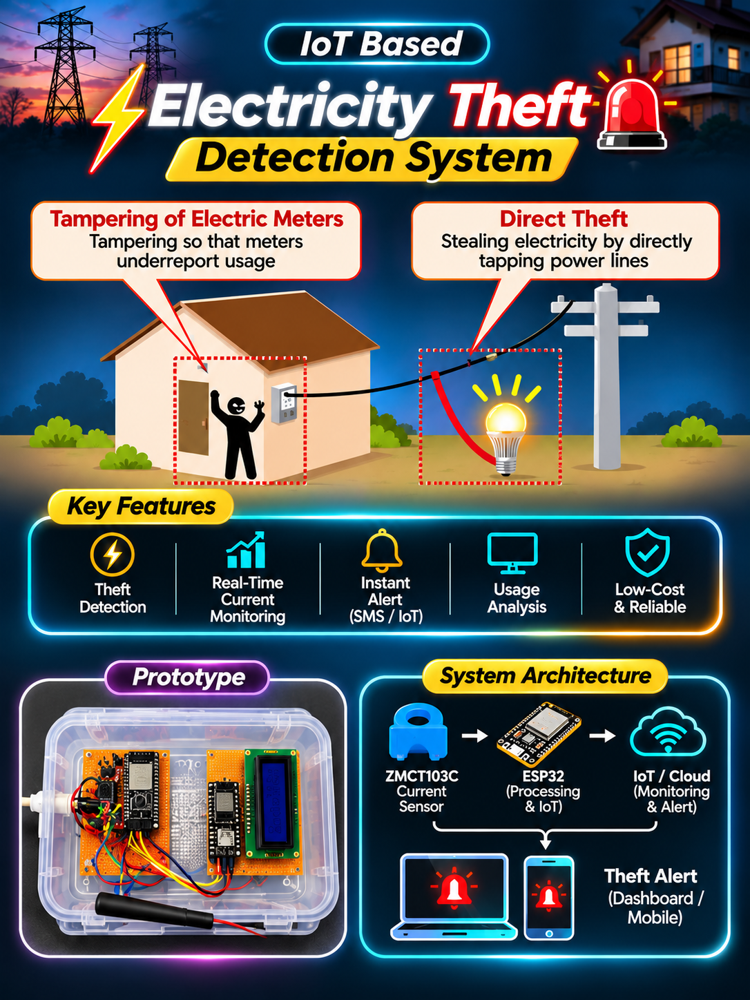

<div align="center">

# ⚡ Smart Electricity Theft Detection & Real-Time Monitoring System
### *Next-Generation IoT Dual-Meter Differential Telemetry & Anti-Theft Grid Protection*

[](https://www.espressif.com/)
[](https://en.wikipedia.org/wiki/Current_transformer)
[](https://www.ti.com/product/ADS1115)
[](https://mqtt.org/)
[-purple?style=for-the-badge)](index.html)
[](LICENSE)

<br/>



</div>

---

## 📖 Executive Summary

Electricity theft accounts for tens of billions of dollars in **Non-Technical Losses (NTLs)** annually for utility companies worldwide. Beyond commercial losses, illegal line tapping and meter tampering degrade power quality, create hazardous grid overloads, cause localized transformer failures, and pose severe fire and electrocution hazards.

The **Smart Electricity Theft Detection System (PowerGuard Pro)** is an end-to-end IoT solution that eliminates power theft using **synchronized dual-meter differential current analysis**. By monitoring the current drawn at the distribution pole (*Meter A*) versus the current recorded at the consumer’s billing meter (*Meter B*), the system detects any unauthorized load tapping or meter tampering in real time, triggers high-priority audio-visual alarms, and enables automated or manual remote line disconnection.

---

## 🎯 The Problem: How Electricity is Stolen

```
                           [ DISTRIBUTION POLE ]
                                     │
                             ( METER A: Supply )
                                     │
              ┌──────────────────────┴──────────────────────┐
              │                                             │
      [ DIRECT THEFT ]                              [ LEGAL CONSUMPTION ]
   (Illegal Tapping Wire)                                   │
              │                                    ( METER B: Consumer )
       [ Stolen Load ]                                      │
   (Bulb / Appliance: 0.035 A)                       [ House Loads ]
                                                   (Under-reported / 0 A)
```

1. **Direct Line Tapping (Pre-Meter Theft):**
   - Perpetrators physically tap into service drop cables or distribution overhead lines *before* current reaches the energy meter.
   - The consumer meter reads `0.000 A` or normal lower load, while the supply line experiences higher draw.
2. **Meter Tampering & Neutral Bypassing:**
   - Physical tampering (disconnection of the current coil, inserting shunt resistors, reverse wiring, or applying high-strength neodymium magnets to saturate transformer cores).
   - The meter under-reports or completely stops recording consumption.

---

## 💡 The Solution: Dual-Meter Differential Telemetry

The system deploys two synchronized metering nodes:
- **Meter A (Supply / Pole Side):** Positioned upstream at the distribution pole or service drop tapping point.
- **Meter B (Consumer / Premises Side):** Positioned at the residential/commercial consumer service panel.

### 📐 Mathematical Principle of Detection

Under normal, untampered operating conditions, according to **Kirchhoff's Current Law (KCL)**:

$$I_{\text{Supply}} (t) = I_{\text{Consumer}} (t) + I_{\text{Technical Loss}} (t)$$

Since technical line loss in short service drops is negligible ($< 0.005\text{ A}$):

$$\Delta I = I_A - I_B \approx 0$$

When theft or line tapping occurs:

$$\Delta I = I_A - I_B > I_{\text{Threshold}}$$

Where:
- $I_A$: Root Mean Square (RMS) current measured at the pole (*Meter A*).
- $I_B$: RMS current measured at the house entrance (*Meter B*).
- $I_{\text{Threshold}}$: Dynamically configurable threshold (calibrated down to **$0.020\text{ A}$** to detect even small loads such as a single $7\text{W} - 9\text{W}$ LED bulb drawing $0.030\text{ A} - 0.040\text{ A}$).
- $\tau_{\text{Debounce}}$: A $1.5\text{-second}$ temporal verification filter prevents false alarms caused by switching transients or inrush currents.

---

## 🌟 Key Features & Capabilities

- ⚡ **Precision Dual-Meter Telemetry:** Simultaneous measurement of AC Voltage ($V_{\text{RMS}}$), Current ($I_{\text{RMS}}$), Active Power ($P$), and Cumulative Energy ($E_{\text{kWh}}$).
- 🚨 **Multi-Tier Audio-Visual Alarm:**
  - **Web Audio API Siren:** Real 960 Hz triple electronic alert chime that sounds authoritatively upon theft detection.
  - **Screen Panic Pulse:** Dynamic red border glow and flashing HUD notification.
  - **Interactive Modal Popup:** Displays instant comparison data with a single-click acknowledgment that transfers alerts to a silent topbar banner.
- 🎚️ **Dynamic Sensitivity Calibration:** Front-end threshold slider ($0.005\text{ A}$ to $0.100\text{ A}$) allows operators to tune sensitivity according to grid conditions.
- 📉 **Real-Time Dynamic Telemetry Chart:** High-frequency Chart.js time-series streaming comparison of Supply vs Consumer current waveforms.
- 🔌 **Remote Relay Load Shedding:** On-board relay modules allow instantaneous remote load cut-off for either line via MQTT.
- 📡 **Dual-Transport MQTT Communication:** Supports standard TCP MQTT (port 1883) for microcontrollers and WebSockets (port 9001) for real-time web dashboards.
- 🕹️ **Built-in Hardware Simulation Mode:** Complete interactive demo mode for evaluation, testing, and presentations without physical sensors connected.
- 📱 **Node-RED & Mobile Alert Ready:** Out-of-the-box flow for forwarding alerts to Telegram, SMS, or cloud databases.

---

## 🧰 Hardware Specifications & Prototype Setup

<div align="center">

| Component | Specification / Part | Purpose in System |
|:---|:---|:---|
| **Microcontroller** | **ESP32 NodeMCU (38-Pin / 30-Pin)** | Core dual-core processor, ADC sampling, Wi-Fi & MQTT publishing |
| **Current Sensor** | **ZMCT103C / ZHT103 / SCT-013-000** | High-precision 1000:1 current transformer for AC line monitoring |
| **ADC Module** | **ADS1115 (16-Bit I2C ADC)** | High-resolution analog-to-digital conversion eliminating ESP32 ADC non-linearity |
| **Voltage Sensor** | **ZMPT101B Module** | Active micro-voltage transformer module for $230\text{V AC}$ mains measurement |
| **Local Display** | **16x2 Character LCD with I2C Backpack** | Field inspection display for on-site voltage, current, and theft status |
| **Relay Actuator** | **5V Single-Channel Relay (10A 250VAC)** | Load isolation and automatic circuit tripping during confirmed theft |
| **Burden Resistor** | **$100\ \Omega$ to $200\ \Omega$ Precision Resistor** | Converts CT secondary current output to measurable AC voltage |
| **Bias Circuit** | **$2\times 10\text{k}\Omega$ Resistors + $10\mu\text{F}$ Capacitor** | Centers AC waveform at $1.65\text{V}$ DC midpoint for single-ended ADC sampling |
| **Enclosure** | **Transparent Weatherproof Field Box** | Protective casing with external cable gland pass-throughs |

</div>

### 📷 Hardware Prototype & Architecture

As demonstrated in the working prototype box:
1. **Sensing Layer:** The live phase conductor passes directly through the **ZMCT103C** core aperture.
2. **Signal Conditioning:** The signal is biased to $1.65\text{V}$ and sampled at 860 samples/sec by the **ADS1115** over I2C.
3. **Edge Processing:** The ESP32 calculates true RMS current over multiple complete $50\text{ Hz}$ AC cycles.
4. **Cloud / Broker Dispatch:** Processed telemetry is packaged as JSON and dispatched via MQTT over local Wi-Fi.

---

## 🔌 Pinout & Wiring Connections

### 1. ADS1115 16-Bit ADC Wiring to ESP32
| ADS1115 Pin | ESP32 Pin | Description |
|:---|:---|:---|
| `VDD` | `3.3V` | Logic & Reference Power |
| `GND` | `GND` | System Ground |
| `SCL` | `GPIO 22` | I2C Clock Line |
| `SDA` | `GPIO 21` | I2C Data Line |
| `ADDR` | `GND` | Sets I2C Address to `0x48` |
| `A0` | CT Sensor Out | Analog input for ZMCT103C AC signal |
| `A1` | ZMPT101B Out | Analog input for AC Voltage signal |

### 2. LCD & Relay Module
| Module | Module Pin | ESP32 Pin | Description |
|:---|:---|:---|:---|
| **I2C LCD 16x2** | `VCC` | `5V (VIN)` | Display power |
| | `GND` | `GND` | Ground |
| | `SDA` | `GPIO 21` | Shared I2C Bus |
| | `SCL` | `GPIO 22` | Shared I2C Bus |
| **Relay Module** | `VCC` | `5V (VIN)` | Relay coil power |
| | `GND` | `GND` | Ground |
| | `IN` | `GPIO 26` | Active-LOW or Active-HIGH control signal |

> 💡 *An interactive SVG wiring diagram is available in [wiring.html](wiring.html).*

---

## 📂 Repository Directory Structure

```plaintext
Smart-Electricity-Theft-Monitor/
├── assets/
│   ├── system_infographic.png       # High-resolution system infographic & poster
│   ├── iot_poster.png               # Conceptual smart electricity IoT poster
│   └── infographic_original.jpg     # Original prototype & architecture photo
├── meterA/
│   └── meterA.ino                   # ESP32 firmware for Supply / Pole Node
├── meterB/
│   └── meterB.ino                   # ESP32 firmware for Consumer / House Node
├── esp32_power_theft/
│   └── esp32_power_theft.ino        # Unified dual-channel single ESP32 firmware
├── test_ct_sensor/
│   └── test_ct_sensor.ino           # Hardware calibration & raw CT test utility
├── test_zmpt101b/
│   └── test_zmpt101b.ino            # Hardware calibration & voltage test utility
├── index.html                       # PowerGuard Pro Web Dashboard (Interactive HUD)
├── style.css                        # Professional dark-mode responsive stylesheet
├── app.js                           # Dashboard MQTT client, charting & state logic
├── mqtt_setup.html                  # In-depth Mosquitto MQTT & WebSockets setup guide
├── wiring.html                      # Interactive SVG circuit wiring documentation
├── nodered_flow.json                # Pre-built Node-RED telemetry & alert flow
├── esp32_direct_noadc.ino           # Direct internal ESP32 ADC fallback firmware
├── .gitignore                       # Git ignore rules for build & OS files
└── README.md                        # Complete project documentation
```

---

## 📡 MQTT Architecture & Telemetry Topics

The system utilizes a structured MQTT topic hierarchy for bi-directional communication between the ESP32 field meters and the monitoring dashboard:

```
meter/
├── A/
│   ├── data      ──> [Publishes JSON telemetry from Pole Node]
│   ├── status    ──> [Publishes connection status: { "online": true }]
│   └── relay     <── [Subscribes to remote switch commands: "ON" / "OFF"]
└── B/
    ├── data      ──> [Publishes JSON telemetry from Consumer Node]
    ├── status    ──> [Publishes connection status: { "online": true }]
    └── relay     <── [Subscribes to remote switch commands: "ON" / "OFF"]
```

### Sample JSON Telemetry Payload (`meter/A/data`)
```json
{
  "voltage": 230.4,
  "current": 0.035,
  "power": 8,
  "energy": 0.0124,
  "relay": true
}
```

---

## 🚀 Quick Start Guide

### Step 1: Clone the Repository
```bash
git clone https://github.com/adityathakre776-stack/Smart-Electricity-Theft-Monitor.git
cd Smart-Electricity-Theft-Monitor
```

### Step 2: Setup MQTT Broker (Mosquitto)
Ensure your MQTT broker has WebSockets enabled so the browser dashboard can connect directly:
1. Open your `mosquitto.conf` file:
   ```conf
   # Standard MQTT TCP port for ESP32
   listener 1883
   allow_anonymous true

   # WebSocket port for PowerGuard Pro Web Dashboard
   listener 9001
   protocol websockets
   ```
2. Start the Mosquitto service:
   ```bash
   mosquitto -c /path/to/mosquitto.conf -v
   ```
   *(For full step-by-step guidance, open [mqtt_setup.html](mqtt_setup.html) in your browser).*

### Step 3: Flash ESP32 Firmware
1. Open `meterA/meterA.ino` (Pole meter) and `meterB/meterB.ino` (Consumer meter) in **Arduino IDE**.
2. Install required libraries from Library Manager:
   - `PubSubClient` by Nick O'Leary
   - `Adafruit ADS1X15` by Adafruit
   - `Adafruit BusIO`
   - `LiquidCrystal_I2C`
3. Update Wi-Fi SSID, Password, and your PC's IP address in the configuration section:
   ```cpp
   const char* WIFI_SSID   = "YOUR_WIFI_OR_HOTSPOT_SSID";
   const char* WIFI_PASS   = "YOUR_PASSWORD";
   const char* MQTT_BROKER = "192.168.1.100"; // Broker IP
   ```
4. Select board **ESP32 Dev Module** and flash both controllers.

### Step 4: Launch Web Dashboard
1. Host the project directory via **XAMPP Apache** (`c:/xampp/htdocs/Electricity`) or run a lightweight local server:
   ```bash
   # Using Python
   python -m http.server 8000
   ```
2. Open `http://localhost/Electricity/` or `http://localhost:8000` in Google Chrome or any modern browser.
3. Enter your WebSocket URL (e.g., `ws://localhost:9001`) and click **Connect**.
4. Test live theft conditions or click **▶ Demo Simulation** to test without hardware!

---

## 🧪 Simulation & Demonstration Mode

If you don't have the hardware wired yet, PowerGuard Pro features a built-in **Real-Time Demo Simulator**:
1. Open `index.html` in your web browser.
2. Click the **▶ Demo Simulation** button in the bottom configuration bar.
3. The dashboard will automatically simulate:
   - Normal idle baseline current on both meters ($\le 0.001\text{ A}$).
   - Sudden unauthorized load tapping on Meter A ($0.035\text{ A}$ LED bulb load).
   - $1.5\text{-second}$ temporal verification before triggering the alarm.
   - 960 Hz electronic siren alert and red blinking HUD modal.
   - Dismissing the alert to the silent topbar notification banner.
   - Turning off the load and automatic recovery to **NORMAL** status.

---

## 🗺 Future Roadmap

- [ ] **AI / ML Anomaly Detection:** Implement tinyML on ESP32 to recognize unauthorized appliance signatures and load patterns.
- [ ] **GSM / SMS Cellular Fallback:** Add SIM800L module support for remote rural substations without Wi-Fi coverage.
- [ ] **LoRaWAN Long-Range Mesh:** Connect multiple pole nodes across city sectors to a centralized LoRa gateway.
- [ ] **Automated Power Cutoff & Recloser:** Implement smart solid-state tripping with automatic reclosing attempts after theft clearance.
- [ ] **GPS Geotagging:** Automatically pinpoint theft coordinates on an interactive Google Maps utility console.

---

## 👨‍💻 Author & Contributions

- **Lead Developer:** [Aditya Thakre](https://github.com/adityathakre776-stack)
- **Repository:** [Smart-Electricity-Theft-Monitor](https://github.com/adityathakre776-stack/Smart-Electricity-Theft-Monitor.git)

Contributions, feature requests, and issue reports are welcome! Feel free to fork this repository, open issues, and submit pull requests.

---

## 📄 License

This project is licensed under the **MIT License** — see the [LICENSE](LICENSE) file for details.
Open-source and free to use for academic, research, and commercial applications.
